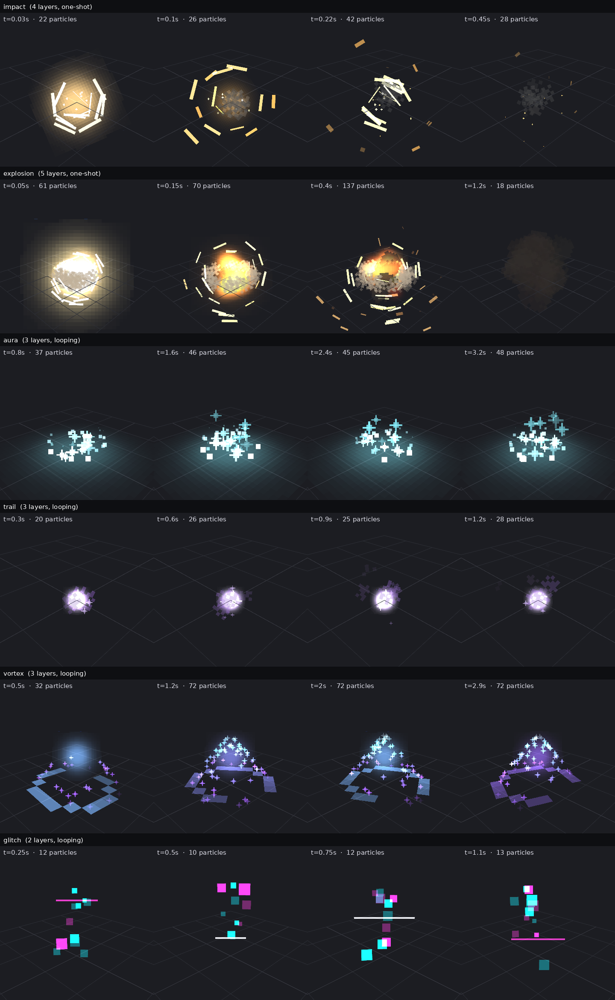
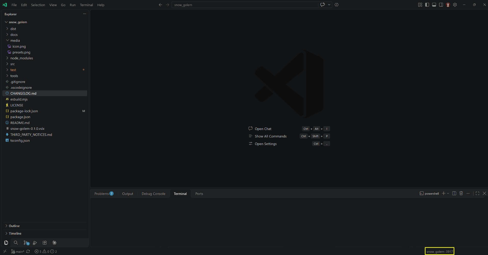

# snow_golem

> AI particle VFX for Minecraft Bedrock. Previews in Snowstorm.

snow_golem is a VS Code extension. It lets an AI assistant like Claude make particle effects inside your
resource pack. The AI can build effects with several layers, check them for mistakes, estimate how heavy
they are, and connect them to your entities and animations. You watch each result in
[Snowstorm](https://github.com/JannisX11/snowstorm), right next to your code.

If your team has no VFX artist, you can ask for "a cyan hit spark for the boss slam" and get a finished
effect. If you already make VFX, you can hand off the repetitive work: color variants, timing changes,
adding effects to animations, and finding Molang typos.



## Install

1. In VS Code, open the Extensions view, click `…`, choose *Install from VSIX…* and pick the `.vsix` file.
   VS Code also installs the Snowstorm extension, which snow_golem needs.
2. Open your addon folder. When the status bar shows `❄ snow_golem :3917`, the server is running.

3. Connect your AI app. Click the status bar item to copy the right setting.

   Claude Code:
   ```bash
   claude mcp add --transport http snow_golem http://127.0.0.1:3917/mcp
   ```
   Claude Desktop, Cursor and other MCP apps:
   ```json
   { "mcpServers": { "snow_golem": { "type": "http", "url": "http://127.0.0.1:3917/mcp" } } }
   ```
   VS Code's own agent mode finds snow_golem by itself.

MCP is the standard way AI apps connect to tools. The server only accepts connections from your own
computer (`127.0.0.1`), and it blocks requests that come from web pages.

## What using it looks like

You type:

> "Make a cyan impact effect for the glitch boss's slam and fire it from the right hand at 0.8s."

1. The AI runs `scan_project` to read your pack: particles, entities, animations and locators.
2. It runs `create_effect` with the `impact` preset and the color `#00F0FF`. You get a diff to review.
   Nothing is saved yet.
3. You say yes. `apply_changes` saves the files and opens the effect in Snowstorm.
4. `attach_to_entity` and `key_into_animation` add the effect to your entity and animation files.
   You review those two small diffs too.
5. You say "the sparks are too slow". The AI uses `edit_effect`, and Snowstorm updates while you watch.

## Tools

| Tool | What it does |
|---|---|
| `scan_project` | Reads the pack: effects and which effects spawn others, entities, animations, locators, textures |
| `list_presets` | Lists the 6 built-in effects: impact, explosion, aura, trail, vortex, glitch |
| `create_effect` | Makes a layered effect from a preset or from layers the AI designs |
| `edit_effect` | Changes values in one file and keeps your comments and formatting |
| `validate` | Finds errors: wrong component names (with a suggested fix), Molang mistakes, unknown variables, bad UVs, missing linked effects |
| `lint_performance` | Counts how many particles are alive at once across all layers, flags expensive settings, and rates the effect for mobile or desktop |
| `apply_changes`, `discard_changes`, `list_pending_changes` | Save, cancel or list the changes waiting for your OK |
| `open_in_snowstorm` | Opens a file in Snowstorm for a live preview |
| `share_link` | Makes a snowstorm.app link for one file, to share on Discord |
| `attach_to_entity` | Gives the effect a short name on a client entity |
| `key_into_animation` | Plays the effect at a time in an animation, on a locator, and checks that the locator exists |

## Layered effects

In Bedrock, one particle file is one emitter, and it can use only one texture and one material. Good VFX
usually need more than that, for example a flash, sparks and smoke. snow_golem makes one file per layer
and puts them in a folder:

```
particles/slam_hit/
  slam_hit.particle.json         ← root: the ID you use in game; controls timing; starts the other layers
  slam_hit_sparks.particle.json
  slam_hit_embers.particle.json
  slam_hit_smoke.particle.json   ← starts 0.05s after the root
```

The root starts the other layers from its event timeline, which runs again on every loop. Only the root
can loop. The other layers always play once, so when the root stops, everything stops with it. Open the
root file in Snowstorm and you see all the layers play together.

## Safety

- The AI cannot save anything on its own. Each change comes back as a diff, and files are only written
  when `apply_changes` runs.
- Before a file is overwritten, a copy goes to `.snow_golem/backups/`. Git ignores that folder.
- Saving stops if the file changed on disk after the diff was made, or if it has unsaved edits in an editor.
- snow_golem only writes inside your project folder, and it refuses links that point outside it.
- If you want speed over review, turn on `snowGolem.autoApply`. Backups still happen.

## Settings

| Setting | Default | Use |
|---|---|---|
| `snowGolem.port` | `3917` | Port for the local server |
| `snowGolem.autoStart` | `true` | Start the server when you open a folder |
| `snowGolem.autoApply` | `false` | Save changes without asking first |
| `snowGolem.performanceBudget` | `mobile` | Budget for performance ratings (`mobile` or `desktop`) |
| `snowGolem.resourcePack` | empty | Which resource pack to use, if the folder has several |
| `snowGolem.projectRoot` | empty | Use a different project folder than the first one in the workspace |

## Without VS Code

```bash
node dist/cli.js --root path/to/addon              # stdio
node dist/cli.js --root path/to/addon --http 3917  # HTTP
```

You get the same tools, but effects cannot open in Snowstorm automatically.

## Development

```bash
npm install
npm run package   # makes snow-golem-0.1.0.vsix
```

`tools/render/` renders effects with Wintersky, so you can check how presets look.

## Planned

- `render_frames`, so the AI can look at its own effect. The renderer for this already works.
- `batch_variants`, for things like a set of elemental colors or a cheaper mobile version.
- A generator for custom sprites and flipbook textures.
- More presets made by the community.

## Credits

Snowstorm, Wintersky and MolangJS are made by [JannisX11](https://github.com/JannisX11). snow_golem would
not exist without them. It is not affiliated with Mojang, Microsoft or JannisX11.

MIT license © Keyyard. See [THIRD_PARTY_NOTICES.md](THIRD_PARTY_NOTICES.md).
